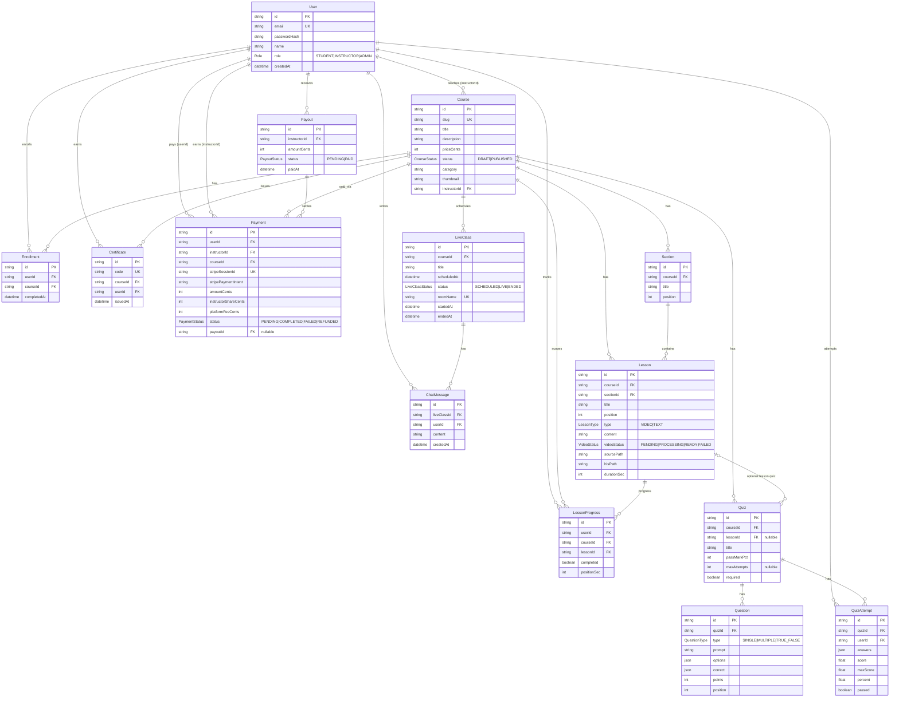

# Data Model

Source of truth: `backend/prisma/schema.prisma` (PostgreSQL, migration `0001_init`). IDs are `cuid()` strings.

## Constraints and indexes

| Table | Unique | Indexes |
|---|---|---|
| User | `email` | |
| Course | `slug` | `(status, category)`, `(instructorId)` |
| Section | | `(courseId, position)` |
| Lesson | | `(courseId)`, `(sectionId, position)` |
| Enrollment | `(userId, courseId)` | `(courseId)` |
| LessonProgress | `(userId, lessonId)` | `(userId, courseId)` |
| Quiz | | `(courseId)` |
| Question | | `(quizId, position)` |
| QuizAttempt | | `(quizId, userId)` |
| Certificate | `code`, `(userId, courseId)` | |
| Payment | `stripeSessionId` | `(instructorId, status)`, `(courseId)` |
| Payout | | `(instructorId)` |
| LiveClass | `roomName` | `(courseId, scheduledAt)` |
| ChatMessage | | `(liveClassId, createdAt)` |

## Notes

- All foreign keys cascade on delete, except `Quiz.lessonId` and `Payment.payoutId`, which are set to `NULL`.
- `Question.options` is `[{ "id": "a", "text": "..." }]`; `Question.correct` is `["a"]` / `["a","c"]`, and `["true"]` or `["false"]` for `TRUE_FALSE`. Correct answers are stripped from quiz payloads sent to students.
- `Payment.instructorShareCents + platformFeeCents = amountCents`. The instructor share is `INSTRUCTOR_SHARE_PCT` (default 80%) and only `COMPLETED` payments count towards revenue.
- A certificate is unique per `(user, course)`; `code` is a public verification code.
