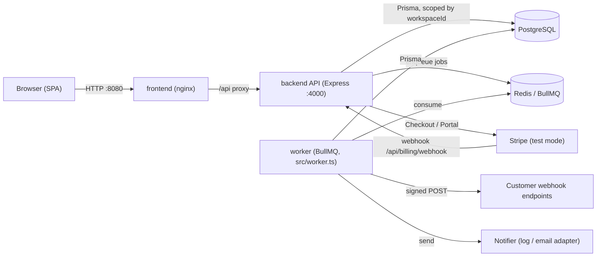

# FS-04 — Multi-Tenant SaaS Project Management Platform

A Jira-lite SaaS: workspaces (tenants) with projects, Kanban boards, configurable workflows, sprints, issues, comments, attachments, reports, audit logs, outbound webhooks, and Stripe-powered subscription billing with plan limits.

> **Stack note.** The original brief mentions Django/Celery. The mandated stack for this build is **Node.js + Express + Prisma + PostgreSQL**, so **BullMQ (on Redis) replaces Celery** for all background work (webhook delivery, notifications, scheduled sprint reports).

- **Backend:** Express 5, TypeScript, Prisma 6, PostgreSQL 16, BullMQ + Redis, Zod, JWT, Stripe (test mode), Vitest
- **Frontend:** `./frontend` (served by nginx in Docker)
- More docs: [API reference](docs/API.md) · [Data model](docs/DATA_MODEL.md)

## Tenant isolation strategy

**Shared database, shared schema, `workspaceId` discriminator.** The `Workspace` is the tenant. Every tenant-owned table (projects, boards, columns, workflow transitions, issues, sprints, comments, attachments, audit logs, webhooks, subscription) carries a `workspaceId` column with an index and a cascade-delete FK.

Isolation is enforced in layers:

1. **Tenant comes from the JWT only.** The token holds `sub` (user) and `wid` (workspace). `authenticate` never reads a workspace from the body, query or headers, and re-loads the `Membership` on every request, so removals and role changes apply immediately.
2. **Scoped Prisma helper** (`src/lib/scoped.ts`): `scoped(workspaceId)` returns a client for every tenant model where every `findMany/findFirst/count/updateMany/deleteMany` has `workspaceId` forced into `where` and every `create/createMany` stamps `workspaceId` into `data` (overriding caller input). It deliberately exposes **no** `findUnique/update/delete`-by-id, since those cannot be tenant-scoped — handlers use `findFirst` + `updateMany/deleteMany`.
3. **Cross-tenant references are validated** (assignee must be a member, sprint/column/board must belong to the same workspace/project). Foreign ids therefore return `404`, never leak data.
4. **Workers are scoped too:** background jobs carry `workspaceId` and load rows through `scoped()`.
5. **RBAC** is checked per route via `requirePermission` (see matrix below).
6. **Tests** cover cross-tenant access attempts (`test/api.test.ts`) and scoping behaviour (`test/misc.test.ts`).

Users are global; one user can belong to several workspaces with a different role in each (`Membership`), and `POST /api/auth/switch-workspace` issues a token for another workspace.

## Architecture



Queues: `webhook-delivery` (HMAC-signed, 6 attempts, exponential backoff), `notifications` (assignment / comment alerts), `sprint-reports` (on-demand, on sprint completion, and a daily 08:00 cron scheduler).

## Features by milestone

| # | Milestone | Delivered |
|---|-----------|-----------|
| 1 | **Multi-tenancy & auth** | Registration creates a user + workspace + OWNER membership + FREE subscription; login, `/auth/me`, workspace switching; JWT; bcrypt; auth rate limiting; `scoped()` tenant isolation |
| 2 | **RBAC & members** | OWNER/ADMIN/MEMBER/VIEWER, permission map (`src/permissions.ts`), member add/role change/removal with owner protections, audit entries |
| 3 | **Projects, boards & workflows** | Projects with unique keys (e.g. `WEB`), default board (To Do / In Progress / Done), column CRUD & reorder, status categories, configurable allowed-transition workflow (409 on forbidden moves) |
| 4 | **Issues & sprints** | Issues (task/bug/story/epic, priority, points, assignee), per-project numbering (`WEB-12`), filters/search, drag-move with position, sprint lifecycle (planned → active → completed, carry-over of incomplete issues), comments, file attachments (MIME allow-list, size cap, tenant-separated storage), issue activity feed |
| 5 | **Reports, audit & notifications** | Sprint report (totals, by-status, burndown ideal line), audit log with filters, assignment/comment notifications via BullMQ |
| 6 | **Webhooks & background jobs** | Per-workspace webhooks for 7 events, `X-Signature: sha256=…` HMAC signing, retry with exponential backoff, scheduled daily sprint reports (BullMQ job scheduler replaces Celery beat) |
| 7 | **Billing & plan limits** | Stripe Checkout + Customer Portal + webhook sync (`checkout.session.completed`, `customer.subscription.updated/deleted`), FREE/PRO/BUSINESS limits enforced with `402 PLAN_LIMIT_EXCEEDED` |

Plans:

| Plan | Price | Projects | Members |
|------|-------|----------|---------|
| FREE | $0 | 1 | 3 |
| PRO | $12 / user / month | 10 | 25 |
| BUSINESS | $29 / user / month | unlimited | unlimited |

## Roles & permissions

| Permission | OWNER | ADMIN | MEMBER | VIEWER |
|---|:-:|:-:|:-:|:-:|
| workspace:read, project:read, issue:read, sprint:read, report:read | ✅ | ✅ | ✅ | ✅ |
| issue:write, comment:write, attachment:write | ✅ | ✅ | ✅ | — |
| project:write, board:write, sprint:write, issue:delete | ✅ | ✅ | — | — |
| member:manage, webhook:manage, audit:read, billing:read | ✅ | ✅ | — | — |
| billing:manage (checkout / portal) | ✅ | — | — | — |

Extra rules: the OWNER cannot be modified or removed; only the OWNER can grant/modify ADMIN; nobody can remove themselves; comments can be deleted by their author or by anyone with `issue:delete`.

## Running with Docker

```bash
cd FS-04
docker compose up --build
# optional demo data
docker compose exec backend npm run seed
```

| Service | URL |
|---|---|
| Frontend | http://localhost:8080 |
| API | http://localhost:4000 (health: `/api/health`) |
| PostgreSQL | localhost:5432 (`pm` / `pm` / `pm`) |
| Redis | localhost:6379 |

The `backend` container runs `prisma migrate deploy` and then the API; `worker` is a separate service running `node dist/worker.js` from the same image. Pass `JWT_SECRET`, `STRIPE_*` in your shell or a root `.env` file for compose to pick up.

## Running locally

Prerequisites: Node 20+, PostgreSQL 16, Redis 7.

```bash
cd FS-04/backend
cp .env.example .env          # edit DATABASE_URL etc.
npm install
npx prisma generate
npx prisma migrate deploy     # or: npm run prisma:migrate  (dev)
npm run seed                  # optional demo data
npm run dev                   # API on :4000
npm run dev:worker            # in a second terminal
```

Scripts: `npm test`, `npm run typecheck`, `npm run build`, `npm start`, `npm run start:worker`, `npm run test:coverage`.

## Environment variables (`backend/.env.example`)

| Variable | Default | Description |
|---|---|---|
| `NODE_ENV` | `development` | `development` / `test` / `production` |
| `PORT` | `4000` | API port |
| `DATABASE_URL` | — | PostgreSQL connection string |
| `REDIS_URL` | `redis://localhost:6379` | BullMQ connection |
| `JWT_SECRET` | dev value | **Must be set** when `NODE_ENV=production` |
| `JWT_EXPIRES_IN` | `7d` | Token lifetime |
| `BCRYPT_ROUNDS` | `10` | Password hashing cost |
| `CORS_ORIGIN` | `http://localhost:5173` | Comma-separated allowed origins |
| `APP_URL` | `http://localhost:5173` | Frontend URL used in Stripe redirect URLs |
| `STRIPE_SECRET_KEY` | — | `sk_test_…` |
| `STRIPE_WEBHOOK_SECRET` | — | `whsec_…` |
| `STRIPE_PRICE_PRO` / `STRIPE_PRICE_BUSINESS` | — | Stripe recurring Price ids |
| `UPLOAD_DIR` | `uploads` | Attachment storage root (one sub-folder per workspace) |
| `MAX_UPLOAD_MB` | `5` | Max attachment size |
| `LOG_LEVEL` | `info` | pino level |

## Seed users

`npm run seed` (wipes and recreates data). All passwords: **`Password123!`**

| Email | Workspace | Role |
|---|---|---|
| owner@acme.test | Acme Corp (PRO) | OWNER |
| admin@acme.test | Acme Corp (PRO) / Globex Inc | ADMIN / VIEWER |
| member@acme.test | Acme Corp | MEMBER |
| viewer@acme.test | Acme Corp | VIEWER |
| owner@globex.test | Globex Inc (FREE) | OWNER |
| member@globex.test | Globex Inc | MEMBER |

Acme has projects `WEB` (restricted workflow) and `API`; Globex has `OPS`. Each has 14 issues, an active and a planned sprint, and comments. `admin@acme.test` belongs to both tenants to demo workspace switching.

## Stripe test-mode setup

1. In the Stripe Dashboard (test mode) create two recurring Products/Prices (Pro, Business); copy the Price ids to `STRIPE_PRICE_PRO` / `STRIPE_PRICE_BUSINESS`.
2. Put your `sk_test_…` key in `STRIPE_SECRET_KEY`.
3. Forward webhooks locally: `stripe listen --forward-to localhost:4000/api/billing/webhook` and copy the printed `whsec_…` to `STRIPE_WEBHOOK_SECRET`.
4. Log in as an OWNER, open Billing, choose a plan, and pay with test card `4242 4242 4242 4242` (any future expiry, any CVC).
5. The webhook upgrades the workspace plan; cancelling in the Customer Portal downgrades it to FREE.

Without Stripe keys the app still runs on the FREE plan; checkout fails with an error (`503 BILLING_NOT_CONFIGURED` when a price id is missing).

## Test results

Run `cd backend && npm test` (Vitest, Prisma mocked — no database needed). `npx tsc --noEmit` is clean.

| Test file | Tests | Result |
|---|---:|---|
| `api.test.ts` (auth, tenant isolation, RBAC, issues, sprints, boards…) | 23 | ✅ pass |
| `billing.test.ts` (Stripe checkout/portal/webhook handling) | 13 | ✅ pass |
| `misc.test.ts` | 13 | ✅ pass |
| `webhooks.test.ts` (signing, delivery, retries) | 8 | ✅ pass |
| `planLimits.test.ts` | 7 | ✅ pass |
| `permissions.test.ts` | 6 | ✅ pass |
| `workflow.test.ts` | 5 | ✅ pass |
| **Backend total** | **75** | **75 passed, 0 failed (7 files)** |
| Frontend `kanban.test.ts` (`cd frontend && npm test`) | 4 | ✅ pass |

### Live end-to-end run (real services)

The API was also exercised against a real PostgreSQL, Redis and the BullMQ worker with seed data: **34 / 34 checks passed**. They covered:

- login and tenant isolation: cross-workspace reads return 404
- role checks: a viewer cannot create issues or read the audit log (403)
- workflow rules: a disallowed move returns 409 and an allowed move succeeds
- comments, attachment upload and download, and rejection of a disallowed file type
- sprint start/complete with a report, audit log entries, billing info
- Stripe checkout returns 503 when keys are unset
- the Free-plan project limit returns 402
- webhook delivery by the worker with a valid HMAC signature

The UI was checked in a browser against that stack: login, project list, Kanban drag-and-drop persisted server-side, a disallowed drop showing the workflow error and reverting, and the audit, webhooks, billing and issue pages loading without errors.

Note: `ioredis` is an explicit dependency, because BullMQ 6 does not bundle it. Use Redis 6.2+ in production (the compose file does).
